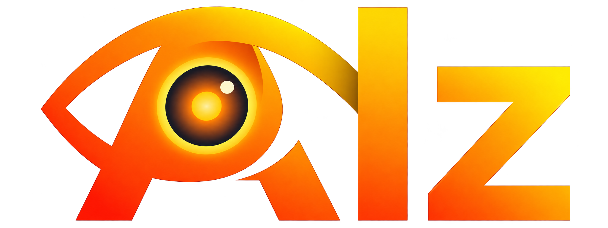
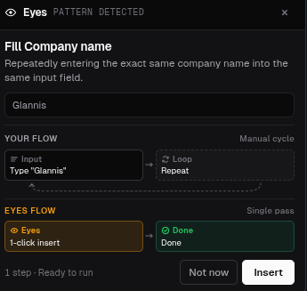
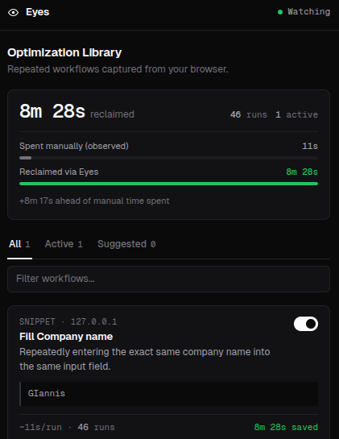
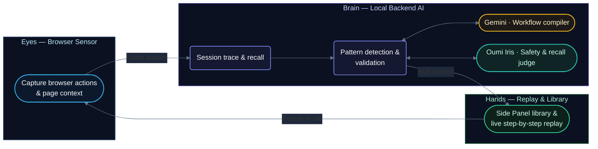

<p align="center">
  
</p>

# AIz (Eyes)

An adaptive assistant that observes repetitive workflows as you work and automates them on the fly. Powered by Gemini and Oumi Iris, it supervises the user while they work, and suggests improved workflows.

Built as a Chrome extension paired with a local backend AI. Instead of writing scripts or setting up integrations ahead of time, you just work normally. When Eyes sees you repeating a workflow, it creates an automated repeatable action for it.

<p align="center">
  
  &nbsp;&nbsp;&nbsp;&nbsp;
  
</p>

## How it works

1. You perform a task in Chrome. The extension captures clicks, typing, navigation, and page context and streams it to the backend.
2. On the first action of a task, the backend checks your saved skills to see if you have already automated a similar flow.
3. As you repeat the sequence, the backend groups the activity into steps and runs two models in parallel:
   - **Gemini** turns the repeated steps and changing inputs into a clean, reusable workflow.
   - **Oumi Iris** runs alongside it as a fast judge to decide if the pattern is worth automating and whether replay should pause before a final submit.
4. Once verified against the open page, Eyes shows a suggestion card in Chrome. Accepting saves the skill to your Side Panel and replays it step by step on screen, with a Stop button whenever you want to take over.

## Use Cases

| Who | How it helps |
| :--- | :--- |
| **Accountant closing the month** | Repetitive per-client clicks turn into one supervised run, so you spend time checking numbers instead of typing them. |
| **New hire** | Common team routines are saved as step-by-step workflows you can inspect and run on day one. |
| **The team** | The people doing the work create the automations themselves instead of waiting on engineering tickets or custom integrations. |

## Architecture



- **Eyes (Browser Sensor):** Runs inside Chrome as an extension. It observes clicks, navigation, and form inputs across tabs and reads the surrounding page structure.
- **Brain (Backend AI):** Runs locally in Node.js. It stitches activity across tabs, detects repeated patterns, recalls saved skills, and coordinates **Gemini** (workflow compiler) and **Oumi Iris** (fast worthiness & safety judge).
- **Hands (Skill Library & Replay):** Saves approved workflows to the Chrome Side Panel and replays them live on the page, highlighting each step and pausing before risky clicks.

## Tech Stack

- **Chrome Extension:** Manifest V3, TypeScript, Chrome Side Panel API
- **Backend:** Node.js, TypeScript, pnpm workspaces
- **AI Models:** Google Gemini (Vertex AI), Oumi Iris
- **Testing & Tooling:** Playwright, Vitest, ESLint

## Future

The browser extension is the starting point for a desktop-wide assistant that learns from work already happening on your machine:

- **Desktop apps:** Bring the same capture, pattern detection, and approval loop to native tools like Excel, ERP clients, mail apps, and PDF viewers.
- **Cross-app workflows without connectors:** Learn multi-step chains across separate apps (such as reading an invoice, updating a ledger, and sending a confirmation) without API keys, plugins, or pre-built integrations.

## Getting Started

```bash
pnpm install
pnpm dev
```

This starts the local backend, builds and loads the Chrome extension, and opens Chrome with the demo apps.

For manual setup, CLI flags, environment config, scripts, and troubleshooting, see [`docs/DEV.md`](docs/DEV.md).

## Documentation

- [`docs/DEV.md`](docs/DEV.md) — full setup, manual Chrome loading, scripts, config, and troubleshooting
- [`docs/ARCHITECTURE.md`](docs/ARCHITECTURE.md) — detailed pipeline architecture and engineering rules
