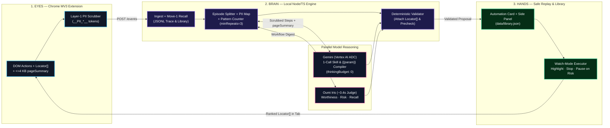

# Eyes (AIz) — Live Browser Workflow Automation

> **Watch once, repeat twice, automate forever.**  
> Eyes observes real work in Chrome, detects repetitive workflows on the fly with **zero per-case rules**, compiles safe parameterized skills using **Gemini + Oumi Iris**, and replays them right inside your browser with full human-in-the-loop control.

---

## What It Is

Most browser automation tools require brittle scripts, hardcoded selectors, or pre-built integrations. **Eyes** flips that model: just use Chrome normally across any web app—forms, spreadsheets, ERPs, or unfamiliar portals.

When you repeat a multi-step routine, Eyes catches the pattern in real time, abstracts variable inputs into `{{parameters}}`, verifies every target element on the live page, and offers a one-click automation card—all while keeping private user data strictly on your machine.

### Core Guarantees

- **Zero Per-Case Rules:** No regex hacks, risk wordlists, or hardcoded demo selectors—works on unseen apps invented live.
- **Privacy-First PII Vault:** Emails, names, and sensitive inputs are scrubbed to `__PII_*__` tokens before leaving the browser and restored locally only during replay.
- **Models Never Write Selectors:** Deterministic code builds ranked `Locator[]` candidates; the LLM only picks step IDs and `{{parameters}}`.
- **Fail-Closed Watch-Mode Replay:** Highlights every step with a live **Stop** button, aborts on ambiguity, and pauses before risky submit actions.

---

## How It Works

1. **Observe & Scrub (Rep 1):** The Chrome extension captures DOM actions, ranked `Locator[]` arrays, and a scrubbed `<=4 KB` page summary—replacing sensitive values with local `__PII_*__` tokens before streaming to the local backend. On Move 1, Eyes also checks saved skills (`data/library.json`) for instant recall.
2. **Detect & Compile in Parallel (Rep 2–3):** The backend merges tabs into a single timeline, splits episodes on `>=30 s` idle gaps, and counts repeated workflows (`minRepeats = 3`, with background precompilation at Rep 2). **Gemini** compiles the structured skill plan while **Oumi Iris** runs in parallel (`~0.4 s`) to judge automation worthiness, safety (`pauseBeforeSubmit`), and borderline recalls.
3. **Validate & Replay:** Deterministic validation attaches `Locator[]` candidates, restores local PII, verifies `matchCount === 1` on open pages, and pops a compact automation card. Accepting saves the skill to the Side Panel library and runs Watch-Mode Replay step-by-step in Chrome.

---

## Architecture: Eyes · Brain · Hands



### Component Breakdown

| Layer | Role | Key Modules |
| :--- | :--- | :--- |
| **Eyes** | Captures DOM events, builds fallback `Locator[]` arrays, extracts scrubbed `<=4 KB` `pageSummary` snapshots, and flushes immediately on commits. | `extension/src/content.ts`, `privacy.ts`, `locators.ts`, `background.ts` |
| **Brain** | Appends JSONL traces, checks Move-1 recall, merges tabs, splits episodes (`>=30 s` idle), maintains the local `__PII_*__` map, runs the pattern counter, and validates compiled steps. | `server/src/app.ts`, `merge-sessions.ts`, `v2/*`, `propose.ts` |
| **AI Models** | **Gemini** compiles trace IDs into parameterized `{{variables}}` via strict `responseSchema`. **Oumi Iris** runs concurrently (`1.5 s` timeout) to score worthiness, flag risky submits, and verify 1-signal recalls. | `server/src/llm/gemini.ts`, `server/src/llm/iris.ts`, `v2/compiler.ts` |
| **Hands** | Persists reusable skills (`startSignature`, `{{parameters}}`, steps) in `data/library.json`, serves the Side Panel, and drives Watch-Mode Replay with fail-closed locator resolution. | `server/src/hands/*`, `extension/src/panel.ts`, `extension/src/hands/execute.ts` |

---

## Tech Stack

- **Browser Sensor & Executor:** Chrome Extension (Manifest V3), TypeScript, Side Panel API
- **Backend & Pipeline:** Node.js, TypeScript (`--experimental-strip-types`), pnpm monorepo (`@gen/shared`, `@gen/server`, `@gen/extension`, `@gen/apps`)
- **Workflow Compiler:** **Google Gemini** (`@google/genai`, Vertex AI ADC, structured JSON `responseSchema`, `thinkingBudget: 0`)
- **Fast Policy & Recall Judge:** **Oumi Iris** (`iris-latest` inference API, non-blocking parallel scoring)
- **Verification & Demo Suite:** Vitest, Playwright, ESLint, local demo apps (`apps/demo`)

---

## Installation & Quick Start

### Setup

```bash
pnpm install
pnpm exec playwright install chromium   # only if no Chrome/Chromium is installed
```

### Start

```bash
pnpm dev
```

Starts the backend (`:8787`), demo app (`:5173`), auto-rebuilding extension, Chrome loaded with `.dev/chrome-profile`, and live trace tail. Press `Ctrl+C` to stop.

```bash
pnpm dev --no-browser   # backend + demo + watcher + tail
pnpm dev --no-watch     # no rebuild
pnpm dev --no-tail      # no trace output
pnpm dev --headless     # headless browser
pnpm dev --port=8787    # backend port
pnpm dev --app-port=5173
pnpm dev --url=http://localhost:3000
```

### Manual

```bash
pnpm server        # backend :8787
pnpm dev:build     # build extension/dist
pnpm dev:demo      # demo app :5173
pnpm dev:tail      # follow traces/*.jsonl
```

Load unpacked in Chrome: `chrome://extensions` → **Developer mode** → **Load unpacked** → select `extension/`.  
After `pnpm dev:build`, reload the extension and the target tab.

```bash
pnpm dev:browser -- --url=http://127.0.0.1:5173/
```

---

## Docs

- [`docs/ARCHITECTURE.md`](./docs/ARCHITECTURE.md) — Full `BRAIN_PIPELINE=v2` design & agent rules
- [`docs/DEV.md`](./docs/DEV.md) — Environment config, npm scripts, verification commands, and troubleshooting
