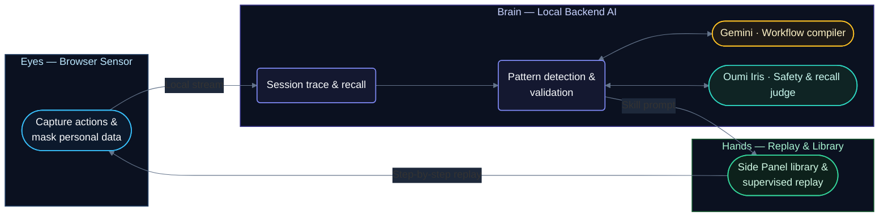

# AIz (Eyes)

An adaptive assistant that observes repetitive workflows as you work and automates them on the fly. Powered by Gemini and Oumi Iris, it supervises the user while they work, and suggests improved workflows.

## What it is

Eyes is made of two parts: a Chrome extension that observes your actions in the browser and replays tasks on screen, and a local backend AI that figures out when you are repeating yourself and builds the automation.

Instead of writing scripts or configuring integrations ahead of time, you work in Chrome as usual across tabs, forms, spreadsheets, or internal tools. When Eyes spots a repeated workflow, it asks if you want to save or finish it automatically, keeps sensitive personal data off external models, and pauses before risky actions like submitting a form.

## How it works

1. You perform a task in Chrome. The extension records your clicks, typing, and page context, strips out sensitive personal fields locally, and sends the trace to the backend.
2. On the first action of a task, the backend checks your saved skill library to see if you have already automated something similar.
3. As you repeat the workflow, the backend groups the trace into steps and runs two models in parallel:
   - **Gemini** compiles the repeated steps and changing inputs into a reusable parameterized workflow.
   - **Oumi Iris** runs alongside it as a fast judge to decide if the workflow is worth automating and whether replay should pause before a final submit.
4. If the workflow checks out on the open page, Eyes shows an automation prompt in Chrome. Accepting saves it to your Side Panel library and runs it step by step in front of you, with a Stop button if you want to take back control.

## Architecture



- **Eyes (Browser Sensor):** Runs inside Chrome as an extension. It watches clicks, navigation, and form inputs, summarizes the page layout, and masks personal info locally before sending anything out.
- **Brain (Backend AI):** Runs locally in Node.js. It combines activity across tabs, spots repeated patterns, checks for previously saved skills, and coordinates **Gemini** (workflow compiler) and **Oumi Iris** (fast automation & safety judge) before restoring local values for execution.
- **Hands (Skill Library & Replay):** Stores approved workflows in a local library shown in the Chrome Side Panel and executes them live in the browser tab, highlighting each step and pausing before risky clicks.

## Tech Stack

- **Chrome Extension:** Manifest V3, TypeScript, Chrome Side Panel API
- **Backend:** Node.js, TypeScript, pnpm workspaces
- **AI Models:** Google Gemini (Vertex AI), Oumi Iris
- **Testing & Tooling:** Playwright, Vitest, ESLint

## Getting Started

```bash
pnpm install
pnpm dev
```

This starts the local backend, builds and loads the Chrome extension, and opens Chrome with the demo apps.

For manual setup, CLI flags, environment config, scripts, and troubleshooting, see [`docs/DEV.md`](docs/DEV.md).

## Documentation

- [`docs/DEV.md`](docs/DEV.md) — full setup, manual Chrome loading, scripts, config, and troubleshooting
- [`docs/ARCHITECTURE.md`](docs/ARCHITECTURE.md) — detailed pipeline architecture and engineering rules
